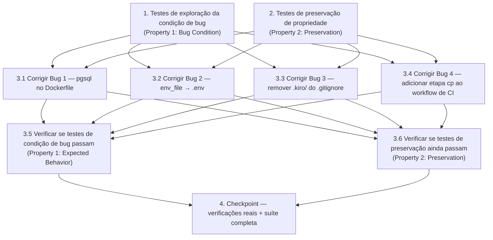

# Implementation Plan:

## Overview

Este plano corrige quatro defeitos de configuração encontrados nos artefatos Docker/CI deste repositório:

1. **Bug 1** — Extensão PHP `pgsql` ausente no `docker/Dockerfile` (apenas `pdo_pgsql` está instalada, quebrando o instalador web do Moodle).
2. **Bug 2** — `env_file` no `docker/docker-compose.yml` aponta para `.env.example` em vez de `.env`, fazendo com que os segredos reais nunca sejam carregados.
3. **Bug 3** — `.kiro/` está listado no `.gitignore`, o que impede que os arquivos de spec sejam rastreados pelo Git.
4. **Bug 4** — O workflow de CI `docker-lint.yml` executa `docker compose config --quiet` sem antes criar `docker/.env`, fazendo a etapa de validação falhar no CI.

A abordagem segue a metodologia exploratória de condição de bug:
- Escrever testes que falham **antes** de tocar qualquer código (Tarefas 1 e 2).
- Aplicar as quatro correções (Tarefas 3.1–3.4).
- Re-executar os mesmos testes para confirmar que todos os bugs foram resolvidos e nenhum comportamento existente regrediu (Tarefas 3.5 e 3.6).
- Checkpoint final com verificações de execução real e a suíte completa de testes (Tarefa 4).

**Arquivo de testes:** Todos os testes das Tarefas 1 e 2 devem ser escritos exclusivamente em `tests/test_docker_local_fixes.py`. Este é o único arquivo novo de testes permitido além dos 4 arquivos do escopo (Dockerfile, docker-compose.yml, .gitignore, docker-lint.yml). **Não criar nenhum outro arquivo de teste.**

---

## Tasks

- [x] 1. Escrever testes de exploração da condição de bug
  - **Property 1: Bug Condition** - Quatro Defeitos de Configuração
  - **CRÍTICO**: Escreva todos os testes em `tests/test_docker_local_fixes.py` ANTES de implementar qualquer correção — a falha confirma que cada bug existe
  - **NÃO tente corrigir os testes ou o código quando eles falharem**
  - **NOTA**: Estes testes codificam o comportamento esperado — eles validarão a correção quando passarem após a implementação
  - **OBJETIVO**: Revelar contraexemplos que demonstram que todos os quatro bugs existem nos artefatos atuais
  - **Abordagem PBT Restrita**: Cada propriedade é restrita ao caso concreto de falha para garantir reprodutibilidade
  - Siga o padrão dos testes existentes: pytest + hypothesis, mesmo estilo de `test_dockerfile_extensions.py` (cabeçalho de feature/property, `_REPO_ROOT`, funções helper, `@given`/`@settings`, `@pytest.mark.parametrize`)

  **Bug 1 — `pgsql` ausente no Dockerfile:**
  - Percorrer `docker/Dockerfile` e coletar todos os tokens nos blocos `docker-php-ext-install` / `pecl install`
  - Afirmar que `"pgsql"` está presente no conjunto de extensões coletadas
  - Executar no código NÃO CORRIGIDO — **RESULTADO ESPERADO: FALHA** (`pgsql` não encontrado, apenas `pdo_pgsql`)
  - Contraexemplo a documentar: `"pgsql"` ausente enquanto `"pdo_pgsql"` está presente

  **Bug 2 — `env_file` aponta para `.env.example`:**
  - Parsear o YAML de `docker/docker-compose.yml` e inspecionar os valores de `env_file` nos serviços `db` e `moodle`
  - Afirmar que cada entrada `env_file` é igual a `".env"` (não `".env.example"`)
  - Executar no código NÃO CORRIGIDO — **RESULTADO ESPERADO: FALHA** (`".env.example"` encontrado em ambos os serviços)
  - Contraexemplo a documentar: `db.env_file == ".env.example"`, `moodle.env_file == ".env.example"`

  **Bug 3 — `.kiro/` bloqueado no `.gitignore`:**
  - Ler `.gitignore` linha a linha e afirmar que nenhuma linha é exatamente `".kiro/"`
  - Executar no código NÃO CORRIGIDO — **RESULTADO ESPERADO: FALHA** (linha `".kiro/"` presente)
  - Contraexemplo a documentar: linha exata `".kiro/"` encontrada no `.gitignore`

  **Bug 4 — CI sem etapa `cp` antes de `config --quiet`:**
  - Ler `.github/workflows/docker-lint.yml` e afirmar que existe uma etapa contendo `cp docker/.env.example docker/.env` E que ela aparece antes da etapa contendo `docker compose config --quiet`
  - Executar no código NÃO CORRIGIDO — **RESULTADO ESPERADO: FALHA** (nenhuma etapa `cp` presente)
  - Contraexemplo a documentar: etapa `config --quiet` encontrada sem etapa `cp` precedente

  - Documentar todos os quatro contraexemplos para entender as causas raiz antes de prosseguir
  - Marcar a tarefa como concluída quando todos os quatro testes estiverem escritos, executados e as falhas documentadas
  - _Requirements: 1.1, 1.2, 1.3, 1.4, 1.5, 1.6, 1.7_

- [x] 2. Escrever testes de preservação de propriedade (ANTES de implementar a correção)
  - **Property 2: Preservation** - Comportamentos Inalterados nos Quatro Arquivos
  - **IMPORTANTE**: Siga a metodologia observation-first — observe o código não corrigido primeiro, depois codifique as asserções
  - **Escreva todos os testes em `tests/test_docker_local_fixes.py`** — não criar nenhum outro arquivo de teste
  - Siga o padrão dos testes existentes: pytest + hypothesis, mesmo estilo de `test_dockerfile_extensions.py`
  - **Observar no código NÃO CORRIGIDO para entradas que não são condição de bug:**
    - `test_dockerfile_extensions.py` passa para todas as nove `MANDATORY_EXTENSIONS` (não relacionadas à ausência de `pgsql`)
    - Todas as chaves do Dockerfile além do bloco `docker-php-ext-install` permanecem inalteradas
    - Estrutura do `docker-compose.yml` — `ports`, `volumes`, `depends_on`, `healthcheck`, `environment` — está intacta
    - `.gitignore` ainda contém `".env"`, `"*.tfvars"`, `"terraform.tfstate"`, `"*.pem"`, `"*.key"`, `"id_rsa"`
    - `.gitignore` ainda ignora `docker/.env` via o padrão existente `".env"` ou `".env.*"`
    - Triggers do workflow (`on.push.paths: docker/**`, `on.pull_request.paths: docker/**`) permanecem inalterados
    - Etapas de hadolint e compose-config permanecem no `docker-lint.yml`

  **Testes de preservação baseados em propriedade a escrever:**
  - Para uma amostra de `MANDATORY_EXTENSIONS` (`mbstring`, `curl`, `zip`, `simplexml`, `intl`, `pdo_pgsql`, `gd`, `opcache`, `sodium`): afirmar que cada uma está presente no bloco de instalação de extensões do Dockerfile — reutiliza/estende a lógica de `test_dockerfile_extensions.py`
  - Para padrões de segurança amostrados (`".env"`, `"*.tfvars"`, `"terraform.tfstate"`, `"*.pem"`, `"*.key"`, `"id_rsa"`): afirmar que cada linha ainda aparece no `.gitignore`
  - Para caminhos amostrados como `docker/.env`, `secret.pem`, `credentials.key`: afirmar que cada um é correspondido pelas regras do `.gitignore` (via correspondência de padrão)
  - Afirmar que o YAML do compose ainda contém as chaves `healthcheck`, `depends_on`, `ports`, `volumes` para ambos os serviços

  - Executar todos os testes no código NÃO CORRIGIDO
  - **RESULTADO ESPERADO**: Todos os testes PASSAM (confirma o comportamento de linha de base a preservar)
  - Marcar a tarefa como concluída quando os testes estiverem escritos, executados e passando no código não corrigido
  - _Requirements: 3.1, 3.2, 3.3, 3.4, 3.5, 3.6, 3.7_

- [x] 3. Corrigir os quatro bugs

  - [x] 3.1 Corrigir Bug 1 — adicionar `pgsql` ao `docker/Dockerfile`
    - No bloco `RUN docker-php-ext-install`, adicionar `pgsql \` imediatamente após a linha `pdo_pgsql \`
    - Adicionar comentário inline `# Driver nativo PostgreSQL (exigido pelo instalador web do Moodle)`
    - Verificar que nenhuma outra linha do bloco foi perturbada
    - _Bug_Condition: `isBugCondition_1(X)` — `NOT contains_install_instruction(X, "pgsql") AND contains_install_instruction(X, "pdo_pgsql")`_
    - _Expected_Behavior: `php_extension_installed(result, "pgsql") AND php_extension_installed(result, "pdo_pgsql")`_
    - _Preservation: todas as nove `MANDATORY_EXTENSIONS` permanecem instaladas; nenhuma nova violação de hadolint_
    - _Requirements: 2.1, 2.2, 3.1_

  - [x] 3.2 Corrigir Bug 2 — alterar `env_file` para `.env` no `docker/docker-compose.yml`
    - Substituir `- .env.example` por `- .env` no bloco `env_file` do serviço `db`
    - Substituir `- .env.example` por `- .env` no bloco `env_file` do serviço `moodle`
    - Remover os comentários `# TODO:` que citavam `.env.example` nos blocos `env_file` dos serviços `db` e `moodle` (esses TODOs foram resolvidos pela troca para `.env`)
    - **Antes de remover qualquer `# TODO:`**, verificar que ainda existe ao menos um `# TODO:` em outro lugar do `docker-compose.yml` — o arquivo atualmente contém `# TODO:` nos blocos de `volumes`, `ports` e no cabeçalho dos serviços, que já satisfazem a exigência de `tests/test_todo_comments.py`
    - Verificar que todas as outras chaves do compose (`ports`, `volumes`, `depends_on`, `healthcheck`, `environment`) estão intocadas
    - _Bug_Condition: `isBugCondition_2(X)` — `X.env_file = ".env.example"` para qualquer um dos serviços_
    - _Expected_Behavior: `env_file_references(result, ".env")` para ambos `db` e `moodle`_
    - _Preservation: healthcheck, depends_on, volumes, ports, environment inalterados; ao menos um `# TODO:` permanece no arquivo_
    - _Requirements: 2.3, 2.4, 2.4a, 3.2, 3.5, 3.6_

  - [x] 3.3 Corrigir Bug 3 — remover linha `.kiro/` do `.gitignore`
    - Deletar a linha exata `.kiro/` do `.gitignore` (localizada após `*.tsbuildinfo` na seção "TypeScript cache")
    - NÃO adicionar nenhum padrão substituto — `.kiro/specs/` deve ser rastreável pelo Git
    - Verificar que todos os outros padrões (`".env"`, `".env.*"`, `"!.env.example"`, `"*.tfvars"`, `"terraform.tfstate"`, `"*.pem"`, `"*.key"`, `"id_rsa"`) permanecem exatamente como estão
    - _Bug_Condition: `isBugCondition_3(X)` — `contains_exact_line(X, ".kiro/")`_
    - _Expected_Behavior: `NOT contains_exact_line(result, ".kiro/") AND git_ignores(result, "docker/.env")`_
    - _Preservation: `docker/.env` ainda ignorado; todos os padrões de segurança intactos; `.env.example` ainda comitado_
    - _Requirements: 2.5, 2.6, 3.3, 3.4, 3.5_

  - [x] 3.4 Corrigir Bug 4 — adicionar etapa `cp` ao `.github/workflows/docker-lint.yml`
    - Inserir uma nova etapa entre "Checkout do repositório" e "Lint do Dockerfile com hadolint":
      ```yaml
      - name: Criar docker/.env a partir do exemplo (CI)
        run: cp docker/.env.example docker/.env
      ```
    - Verificar que a nova etapa aparece **antes** da etapa "Validar docker-compose.yml"
    - Verificar que os triggers do workflow (`on.push.paths`, `on.pull_request.paths`) e todas as etapas existentes permanecem inalterados
    - _Bug_Condition: `isBugCondition_4(X)` — `has_step(X, "docker compose config --quiet") AND NOT has_step_before(X, "docker compose config --quiet", "cp docker/.env.example docker/.env")`_
    - _Expected_Behavior: `step_exists_before(result, "cp docker/.env.example docker/.env", "docker compose config --quiet")`_
    - _Preservation: workflow ainda dispara em `docker/**`; etapa de hadolint e todas as outras etapas inalteradas_
    - _Requirements: 2.7, 3.7_

  - [x] 3.5 Verificar se os testes de exploração da condição de bug agora passam
    - **Property 1: Expected Behavior** - Quatro Defeitos de Configuração Resolvidos
    - **IMPORTANTE**: Re-executar os MESMOS quatro testes de `tests/test_docker_local_fixes.py` da Tarefa 1 — NÃO escrever novos testes
    - Os testes da Tarefa 1 codificam o comportamento esperado para todos os quatro bugs
    - Executar os testes de exploração do passo 1 contra os arquivos corrigidos
    - **RESULTADO ESPERADO**: Todos os quatro testes PASSAM (confirma que todos os bugs foram corrigidos)
    - _Requirements: 2.1, 2.2, 2.3, 2.4, 2.5, 2.6, 2.7_

  - [x] 3.6 Verificar se os testes de preservação ainda passam
    - **Property 2: Preservation** - Comportamentos Inalterados nos Quatro Arquivos
    - **IMPORTANTE**: Re-executar os MESMOS testes de `tests/test_docker_local_fixes.py` da Tarefa 2 — NÃO escrever novos testes
    - Executar os testes de preservação do passo 2 contra os arquivos corrigidos
    - Executar `pytest tests/test_dockerfile_extensions.py` e confirmar que todos os testes passam
    - **RESULTADO ESPERADO**: Todos os testes PASSAM (confirma que nenhuma das quatro correções introduziu regressões)

- [x] 4. Checkpoint — Verificações de execução real e suíte completa de testes

  Execute as verificações abaixo nesta ordem:

  1. **Validar configuração do Compose:**
     ```sh
     docker compose -f docker/docker-compose.yml config --quiet
     ```
     Confirmar saída vazia e exit code 0 (requer `docker/.env` presente na pasta `docker/`).

  2. **Subir os contêineres:**
     ```sh
     docker compose -f docker/docker-compose.yml up -d --build
     ```
     Confirmar que todos os contêineres (`db` e `moodle`) atingem o estado `running`.

  3. **Verificar extensões PHP dentro do contêiner:**
     ```sh
     docker compose -f docker/docker-compose.yml exec moodle php -m
     ```
     Confirmar que a saída contém **`pgsql`** e **`pdo_pgsql`**.

  4. **Lint do Dockerfile com hadolint:**
     ```sh
     docker run --rm -i hadolint/hadolint < docker/Dockerfile
     ```
     Executar e **registrar** o resultado. Se houver violações que já existiam antes desta spec, apenas documentar — não corrigir aqui.

  5. **Suíte completa de testes Python:**
     ```sh
     pytest tests/
     ```
     Confirmar que todos os testes passam.

  6. **Confirmar que `docker/.env` ainda é ignorado pelo Git:**
     ```sh
     git check-ignore docker/.env
     ```
     Confirmar que o comando retorna o arquivo (ainda ignorado).

  7. **Confirmar que os arquivos de spec não são ignorados pelo Git:**
     ```sh
     git check-ignore .kiro/specs/docker-local-fixes/bugfix.md
     ```
     Confirmar que o comando **não** retorna o arquivo (não ignorado após remoção de `.kiro/` do `.gitignore`).

  - Garantir que todas as verificações passam; perguntar ao usuário caso surja alguma dúvida.

  ### Resultados da verificação

  - **1ª execução (Windows):** falhou — Docker Desktop fechado (daemon indisponível: `npipe:///./pipe/dockerDesktopLinuxEngine`).
  - **Reexecutado manualmente no WSL (bash):**
    - `docker compose up -d --build` → `db` healthy, `moodle` up. ✅
    - `docker compose exec moodle php -m | grep pgsql` → `pdo_pgsql`, `pgsql`. ✅
    - `scripts/health-check.sh http://localhost:8080` → `[✓]`, exit 0. ✅
    - `docker run --rm -i hadolint/hadolint < Dockerfile` (WSL) → `DL3008` (warning, linha 17), `DL3059` (info, linhas 59 e 147); avisos pré-existentes; exit 1 → registrado e tratado no Bug 5.

- [x] 5. Corrigir Bug 5 — hadolint falha por avisos pré-existentes no docker-lint.yml

  - Atualizar o step "Lint do Dockerfile com hadolint" em `.github/workflows/docker-lint.yml`
  - Substituir o comando atual:
    ```sh
    docker run --rm -i hadolint/hadolint < docker/Dockerfile
    ```
    pelo comando:
    ```sh
    docker run --rm -i hadolint/hadolint hadolint --failure-threshold warning --ignore DL3008 - < docker/Dockerfile
    ```
  - Adicionar comentário explicativo no step:
    ```yaml
    # DL3008: ignorado — fixar versões apt quebra o build quando o Debian remove versões antigas.
    # DL3059: info (múltiplos RUN consolidáveis) — não bloqueia; permanece visível no log.
    ```
  - Verificar que os triggers e os demais steps permanecem inalterados
  - _Bug_Condition: `isBugCondition_5(X)` — `hadolint_exit_code(X) != 0` por avisos pré-existentes sem `--failure-threshold` nem `--ignore`_
  - _Expected_Behavior: `hadolint_exit_code(result) = 0` com `--failure-threshold warning --ignore DL3008`_
  - _Requirements: 3.7_

---

## Task Dependency Graph



```json
{
  "waves": [
    {"wave": 1, "tasks": ["1", "2"]},
    {"wave": 2, "tasks": ["3.1", "3.2", "3.3", "3.4"]},
    {"wave": 3, "tasks": ["3.5", "3.6"]},
    {"wave": 4, "tasks": ["4"]}
  ]
}
```

As tarefas 3.1–3.4 são independentes entre si e podem ser aplicadas em qualquer ordem (ou em paralelo). Os testes de exploração (Tarefa 1) e os testes de preservação (Tarefa 2) devem ser escritos e executados no código não corrigido antes de qualquer correção ser aplicada.

---

## Notes

- **Execute os testes antes de corrigir.** As Tarefas 1 e 2 devem ser concluídas — com os resultados esperados de aprovação/reprovação confirmados — antes de tocar qualquer arquivo-fonte. Pular essa etapa derrota o propósito da metodologia exploratória.
- **Arquivo de testes unificado.** Todos os testes das Tarefas 1 e 2 vivem em `tests/test_docker_local_fixes.py`. Não criar nenhum outro arquivo de teste. O arquivo deve seguir o mesmo estilo de `test_dockerfile_extensions.py`: cabeçalho de feature/property, `_REPO_ROOT` via `pathlib`, funções helper, `@given`/`@settings` do Hypothesis e `@pytest.mark.parametrize`.
- **Ressalva sobre volume no Bug 2.** Alterar `env_file` de `.env.example` para `.env` só tem efeito quando um arquivo real `docker/.env` existe no host. O arquivo é ignorado pelo Git, então cada desenvolvedor deve criá-lo localmente (ex.: `cp docker/.env.example docker/.env`) antes de executar `docker compose up`. Documentar isso no README do projeto se ainda não estiver coberto.
- **`docker/.env` deve existir localmente.** Tanto `docker compose config` quanto `docker compose up` falharão se `docker/.env` estiver ausente. Sempre execute `cp docker/.env.example docker/.env` (e preencha os segredos) antes de invocar comandos do Compose localmente.
- **Manter ao menos um `# TODO:` no docker-compose.yml.** O arquivo `tests/test_todo_comments.py` verifica que todo `.yml` em `docker/` contém ao menos um `# TODO:`. Ao remover os comentários TODO resolvidos dos blocos `env_file`, confirme que outros `# TODO:` (em `volumes`, `ports`, cabeçalhos de serviço) ainda estão presentes.
- **Posicionamento da etapa `cp` no CI.** A nova etapa em `docker-lint.yml` (Tarefa 3.4) deve aparecer estritamente antes da etapa `docker compose config --quiet`. Confirme a ordem das etapas no YAML após a edição — erros de indentação YAML podem silenciosamente reordenar as etapas.
- **Não substituir `.kiro/` por um padrão mais restrito.** A correção do Bug 3 é uma deleção pura. Adicionar de volta um padrão como `.kiro/*.log` pode inadvertidamente ignorar arquivos de spec. Deixe `.kiro/` completamente sem menção no `.gitignore`.
- **Reutilize os testes, não os reescreva.** As Tarefas 3.5 e 3.6 explicitamente re-executam os testes das Tarefas 1 e 2. Escrever novos testes para verificação está incorreto — o valor da metodologia vem das mesmas asserções falhando antes da correção e passando depois.
